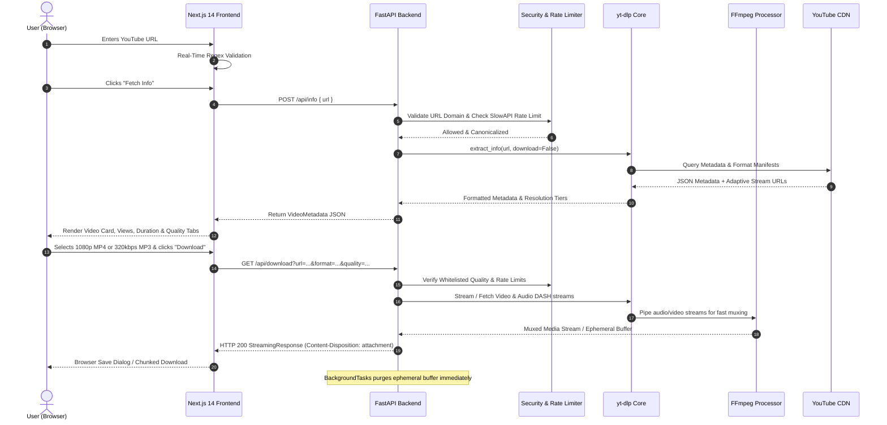

# StreamForge: Modern YouTube Video (MP4) & Audio (MP3) Streaming Suite

StreamForge is an enterprise-grade, high-performance web application engineered to extract and stream public YouTube videos (up to 1080p Full HD) and crystal-clear audio (up to 320kbps MP3). 

Built with **Next.js 14 (App Router)** on the frontend and **Python FastAPI** powered by native **yt-dlp** and **FFmpeg** on the backend.

---

## 1. System Architecture & Request Lifecycle



---

## 2. Key Architecture Decisions

| Component | Selected Technology | Rationale |
| :--- | :--- | :--- |
| **Backend Engine** | **Python (FastAPI) + `yt-dlp`** | YouTube frequently updates signature ciphers and anti-bot checks. Node.js libraries (`@distube/ytdl-core`) frequently break and require manual patches. Native `yt-dlp` in Python receives immediate updates and offers in-process, non-blocking execution. |
| **Media Transcoder** | **FFmpeg v7** | YouTube serves 1080p video as a separate video-only DASH track and audio in an Opus/AAC track. FFmpeg muxes both into an MP4 container at native speeds without re-encoding video frames (`-c:v copy`). |
| **Disk Management** | **Ephemeral Streaming Buffer + Auto-Purge** | Media streams directly to client HTTP responses via `StreamingResponse`. Any temporary muxing buffer is stored in an ephemeral RAM `tmpfs` (or disk) and deleted immediately upon transfer completion or disconnect. |
| **Security Layer** | **Strict SSRF & Injection Defense** | Input URLs are strictly parsed against an explicit whitelist of YouTube domains (`youtube.com`, `youtu.be`). The 11-character video ID is extracted and normalized to canonical format, preventing command injection, shell arguments, or internal network SSRF. |
| **Rate Limiting** | **SlowAPI (IP-based)** | Prevents denial-of-service and abuse. Configured for 30 info lookups/min and 10 downloads/min per IP. |

---

## 3. Directory Layout

```text
├── backend/
│   ├── app/
│   │   ├── config.py           # Environment settings & thresholds
│   │   ├── exceptions.py       # Standardized error hierarchy
│   │   ├── main.py             # FastAPI endpoints & CORS
│   │   ├── schemas.py          # Pydantic models
│   │   └── services/
│   │       ├── security.py     # Regex validation & SSRF defense
│   │       ├── streamer.py     # FFmpeg pipeline & file cleanup
│   │       └── youtube.py      # yt-dlp native extraction
│   ├── Dockerfile              # Multi-stage Python 3.11 with FFmpeg
│   └── requirements.txt
├── frontend/
│   ├── src/
│   │   ├── app/                # Next.js 14 App Router (layout, page, styles)
│   │   ├── components/         # Modular UI (Header, VideoCard, FormatSelector, etc.)
│   │   └── lib/                # API client, TypeScript definitions, regex utils
│   ├── Dockerfile              # Multi-stage Next.js standalone runner
│   ├── package.json
│   └── tailwind.config.ts
├── docker-compose.yml          # Container orchestration with tmpfs RAM buffer
└── README.md
```

---

## 4. Quick Start (Local Development)

### Prerequisites
1. **Python 3.10+**
2. **Node.js 18+**
3. **FFmpeg** installed and accessible in your system `PATH`.
   - Windows: `winget install Gyan.FFmpeg` or download from gyan.dev
   - Ubuntu/Debian: `sudo apt update && sudo apt install -y ffmpeg`
   - macOS: `brew install ffmpeg`

### 1. Run the Backend
```bash
cd backend
python -m venv venv

# Windows:
venv\Scripts\activate
# Linux/macOS:
source venv/bin/activate

pip install -r requirements.txt
uvicorn app.main:app --host 0.0.0.0 --port 8000 --reload
```
API Documentation will be live at: `http://localhost:8000/docs`

### 2. Run the Frontend
```bash
cd frontend
npm install
npm run dev
```
Open your browser at: `http://localhost:3000`

---

## 5. Deployment with Docker Compose

To deploy both services with native dependencies and an ephemeral RAM buffer:

```bash
docker compose up --build -d
```

- **Frontend:** `http://localhost:3000`
- **Backend API:** `http://localhost:8000`
- **Health Check:** `http://localhost:8000/api/health`

---

## 6. API Reference

### `POST /api/info`
Validates a YouTube URL and returns video metadata, thumbnail, duration, view count, and available format resolutions.

**Request Body:**
```json
{
  "url": "https://www.youtube.com/watch?v=dQw4w9WgXcQ"
}
```

### `GET /api/download`
Streams the processed media directly to the browser with `Content-Disposition: attachment`.

**Query Parameters:**
- `url` *(string, required)*: The YouTube URL.
- `format` *(string, required)*: `"video"` or `"audio"`.
- `quality` *(string, required)*:
  - Video: `"1080p"`, `"720p"`, `"480p"`, `"360p"`
  - Audio: `"320kbps"`, `"192kbps"`, `"128kbps"`
